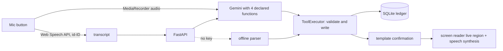

# SuaraUsaha

*Suara* means voice and *usaha* means business. SuaraUsaha is a voice first bookkeeping assistant for Indonesian warung owners and other micro businesses. The owner says what happened in everyday Bahasa Indonesia ("jual tiga kopi lima ribu", "bu Sri ngutang dua indomie"), and it becomes a structured ledger entry, with the confirmation read back aloud.

It grew out of a consulting case on financing for rural Indonesian MSMEs, where a recurring barrier was the lack of simple records lenders can use. Many owners keep no books at all, often because writing and apps get in the way. Speaking is easier.

* **Gemini function calling** turns speech or text into `record_sale`, `record_expense`, `get_daily_summary` and `undo_last_entry` calls. The backend validates and executes every call itself, and confirmations come from templates, so what the user hears always matches what was saved.
* **An offline Bahasa Indonesia parser** handles number words ("seratus lima puluh ribu"), slang units (15rb, 1,5jt), measure words, credit sales, QRIS and multi item phrases when there is no network or API key.
* **An accessible React interface** designed to WCAG 2.1 AA, for owners with low literacy, low vision or older phones. See [ACCESSIBILITY.md](ACCESSIBILITY.md).



## Try it

```bash
# backend
cd backend
python -m venv .venv && source .venv/bin/activate
pip install -e ".[dev]"
pytest -q
uvicorn suarausaha.api:app --reload --port 8000

# frontend, in a second terminal
cd frontend
npm install
npm test          # component tests with axe-core checks, plus colour contrast checks
npm run dev       # http://localhost:5173, proxies /api to port 8000
```

Add `GOOGLE_API_KEY` (see `.env.example`) to use Gemini. That also enables uploading recorded audio, so voice works in browsers without the Web Speech API.

Or run everything in one container:

```bash
docker build -t suarausaha .
docker run -p 8080:8080 -e GOOGLE_API_KEY=$GOOGLE_API_KEY -v suarausaha-data:/data suarausaha
```

## Phrases it understands

| Spoken | Recorded |
|---|---|
| jual tiga kopi lima ribu | sale, 3 kopi at Rp5.000, Rp15.000 total |
| laku 2 nasi goreng 15rb pakai qris | sale paid by QRIS |
| bu Sri ngutang dua indomie 3500 | credit sale to Bu Sri, counted as outstanding |
| jual 4 es teh total 20 ribu | total price, so Rp5.000 each |
| beli 2 karung beras 300 ribu dan bayar listrik 150rb | two expenses |
| rekap hari ini | spoken daily summary |
| batalkan yang terakhir | removes the last entry |

When the price is missing, it asks ("Harga untuk kopi belum disebut.") rather than guessing.

## API

| Method | Path | Purpose |
|---|---|---|
| `POST` | `/api/entries/text` | `{text}` to entries, with `speech` to read back |
| `POST` | `/api/entries/voice` | multipart `audio` (webm, ogg, wav, mp3, m4a); Gemini only |
| `GET` | `/api/entries?day=YYYY-MM-DD` | entries, newest first |
| `DELETE` | `/api/entries/last` | undo |
| `GET` | `/api/summary?day=YYYY-MM-DD` | sales, cash received, credit outstanding, expenses, estimated profit |
| `GET` | `/api/health` | engine in use and whether audio upload is available |

Amounts are stored as whole rupiah integers, and days follow Asia/Jakarta time.

## Layout

```
backend/suarausaha/
  parser.py      offline Bahasa Indonesia parser
  bookkeeper.py  Gemini function calling, offline engine, shared ToolExecutor
  ledger.py      SQLite ledger and daily summary
  api.py         FastAPI, also serves the built web app
frontend/src/
  App.jsx        the interface
  useVoice.js    Web Speech API or MediaRecorder capture
  theme.js       colour tokens and the WCAG contrast calculation
  *.test.jsx     behaviour and axe-core accessibility tests
```

## License

MIT
